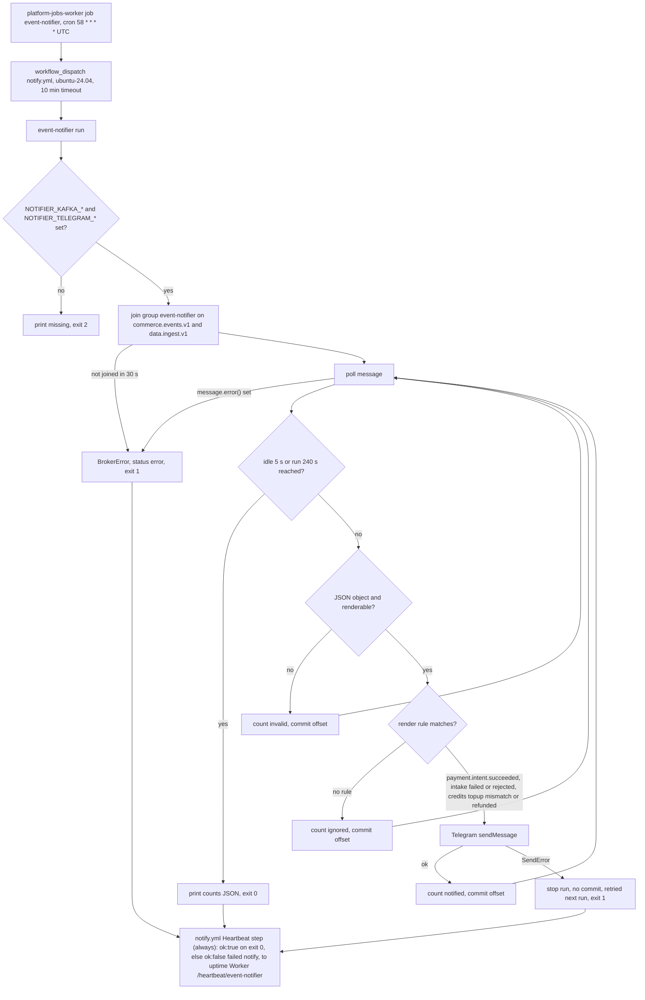

# 01 — Business process (As-Is / To-Be)

platform-event-notifier คือ Kafka consumer ตัวแรกตาม ADR-0008 ที่อ่าน event จากหัวข้อ `commerce.events.v1` และ `data.ingest.v1` แล้วส่งข้อความ Telegram ให้ owner เมื่อมีการชำระเงินสำเร็จ, intake ล้มเหลว/ถูกปฏิเสธ, หรือ credits top-up ผิดปกติ รันเป็น GitHub Actions ทุกชั่วโมงที่ :58 UTC ผ่าน job queue ของ platform-jobs-worker

Last reviewed: 2026-11-27 · commit `c110533`

## As-Is (จากโค้ดวันนี้)

Sources: `src/event_notifier/consumer.py` (`main`, `run`, `_drain`, `KafkaConsumer`, `init_group`, `telegram_sender`), `src/event_notifier/rules.py` (`render`), `.github/workflows/notify.yml` (Heartbeat step), `specs/001-event-notifier/spec.md`, `README.md`

ข้อเท็จจริงสำคัญจากโค้ด:

- at-least-once: event ที่ต้องแจ้งจะ commit offset หลังส่งสำเร็จเท่านั้น (event `ignored`/`invalid` commit โดยไม่ส่ง); crash ระหว่างส่งกับ commit ทำให้ข้อความซ้ำได้ 1 ข้อความ; broker error จาก poll หยุดรันโดยไม่ commit
- `event-notifier init-group` ปักกลุ่มใหม่ที่ปลายหัวข้อ (ไม่ replay ประวัติ); ขั้นนี้รันมือ ไม่อยู่ใน workflow
- heartbeat ส่งจากขั้น `Heartbeat` (`if: always()`) ใน `.github/workflows/notify.yml` ตาม exit code ของ notifier
- ตัวนับ `invalid` รวม body ที่ไม่ใช่ JSON object และ event ที่ render ไม่ได้ (เช่น ไม่มี amount) เพื่อไม่ให้ event เสียเดียวบล็อกกลุ่ม

## To-Be (จาก `specs/001-event-notifier/spec.md`)

ไม่มี To-Be ที่เขียนไว้: spec 001 (accepted 2026-11-04) อธิบายพฤติกรรมปัจจุบัน ไม่ได้กำหนดสถานะเป้าหมายที่ต่างออกไป ส่วนที่ spec เขียนว่า "Behaviour" มีเพียง 2 rule (payment และ intake) ขณะที่โค้ดมี rule credits เพิ่ม (ดู G1)

Sources: `specs/001-event-notifier/spec.md`

## Gap

| ID | As-Is → To-Be | Status | Owner | Evidence |
|---|---|---|---|---|
| G1 | โค้ดมี rule `credits.topup.mismatch` และ `credits.topup.refunded` (commit a09138e) แต่ spec 001 ยังระบุแค่ 2 rule → spec ตรงกับโค้ด | todo | claude | `src/event_notifier/rules.py`; `specs/001-event-notifier/spec.md` |
| G2 | ไม่มี To-Be ของกระบวนการ (ช่องทางอื่นนอก Telegram, เวลาแจ้งที่เร็วกว่า 1 ชั่วโมง ซึ่งถูกจำกัดโดย relay รายชั่วโมง) → owner กำหนด | decide | owner | ไม่มีใน `specs/` หรือ `README.md` |

## Open questions

- `init-group` เป็นขั้นตอนมือครั้งเดียวหรือไม่ ไม่มี workflow รันให้
